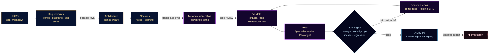
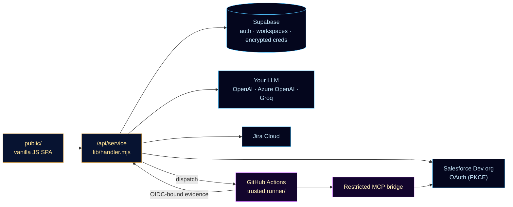

<p align="center">
  
</p>

<p align="center">
  
</p>

<p align="center">
  <a href="https://salesforce-delivery-agent.vercel.app"></a>
</p>

<p align="center">
  
  
  <a href="https://github.com/kamikaze1120/salesforce-delivery-agent/actions/workflows/ci.yml"></a>
  <a href="LICENSE"></a>
  
</p>

**Delivery Studio** is a governed Salesforce delivery agent. You give it a business requirements document (BRD). It produces a requirement-linked plan, follow-up questions, Jira stories, a reviewed architecture, concept mockups, allowlisted Salesforce metadata, and requirement-linked tests. It then validates and tests that exact package, and makes a bounded repair when a non-production stage fails. A human approves every gate.

<p align="center"><sub><code>BRD → SDLC</code> ✦ <code>HUMAN APPROVAL</code> ✦ <code>SALESFORCE MCP</code> ✦ <code>JIRA</code> ✦ <code>GITHUB ACTIONS</code> ✦ <code>SUPABASE</code></sub></p>

> [!WARNING]
> **Pilot scope. Read this first.**
> - The web app only connects to a Salesforce **sandbox** or an **explicitly verified Developer Edition** org. Production and unverified orgs are refused. Only the **Dev** org has been verified live.
> - **Production promotion is hard-disabled in the app** and returns `403`. The repository includes a gated GitHub Actions path (Dev → QA → UAT → business approval → production), but the saved pipeline configuration is **disabled**. It has **never** been run end to end against live orgs.
> - Passing unit tests or a green Vercel build does **not** mean the app is ready for Salesforce production. See [environment readiness](docs/ENVIRONMENT-READINESS.md).

<h2 align="center">✦ HOW A DELIVERY FLOWS ✦</h2>
<p align="center"><sub>EVERY ARROW INTO A STAGE PASSES A HUMAN GATE</sub></p>



<table>
  <tr>
    <td width="33%" valign="top">🧭 <b>Clarify</b><br><sub>Reads the original BRD and asks blocking questions. Builds Jira stories and structured test cases that cover every acceptance criterion.</sub></td>
    <td width="33%" valign="top">🏛️ <b>Architect + mock up</b><br><sub>Code generation needs an approved Salesforce architecture first. Concept mockups go through revisions and an approval.</sub></td>
    <td width="33%" valign="top">🧱 <b>Generate</b><br><sub>Writes Apex, custom objects, draft Flows, permission sets, LWC, triggers, tabs and Lightning apps, with strict metadata path checks.</sub></td>
  </tr>
  <tr>
    <td valign="top">🧪 <b>Validate + test</b><br><sub>Validates the exact package with <code>RunLocalTests</code>, <code>rollbackOnError</code>, and warnings treated as failures. Then runs Apex and declarative browser tests.</sub></td>
    <td valign="top">🛡️ <b>Quality gate</b><br><sub>Unknown or incomplete evidence blocks promotion. Evidence comes from observed results only, never from model claims or uploaded pass files.</sub></td>
    <td valign="top">🔁 <b>Bounded repair</b><br><sub>Has a repair budget and a pause switch. It cannot touch tests, requirements, mockups or permission sets. Ambiguous writes stop the automation.</sub></td>
  </tr>
  <tr>
    <td valign="top">👥 <b>Separation of duties</b><br><sub>A configurable rule (warn by default, or enforce) checks that the person who approves is not the author or a previous approver.</sub></td>
    <td valign="top">🔔 <b>Attention feed</b><br><sub>Role-aware in-app notifications for questions and review decisions waiting on you.</sub></td>
    <td valign="top">🧾 <b>Review aid + release report</b><br><sub>A per-file change summary for code review, and a traceable release report after UAT.</sub></td>
  </tr>
</table>

<h2 align="center">◈ TRY IT IN 60 SECONDS ◈</h2>
<p align="center"><sub>NO CREDENTIALS NEEDED FOR THE SAMPLE</sub></p>

```sh
git clone https://github.com/kamikaze1120/salesforce-delivery-agent.git
cd salesforce-delivery-agent
npm ci --ignore-scripts   # Node.js 22
npm run dev               # http://localhost:3000
```

Choose **Open sample workspace**. The sample is a fixture. It makes no live LLM calls and does no deployments.

```sh
npm test        # node --test: 204 test cases across 41 files
npm run build   # runs scripts/check.mjs
```

<h2 align="center">◆ GROUNDING AND SAFETY ◆</h2>
<p align="center"><sub>LIMITS ON UNSUPPORTED BEHAVIOR</sub></p>

"Zero hallucinations" cannot be guaranteed. Instead, the studio grounds the work in exact BRD excerpts, requirement IDs, reviewed mockups, frozen test expectations, strict metadata paths, verified target identities, a signed runner identity, and **actual** Salesforce and Playwright results. **A model response is never accepted as test evidence.**

- **Runner identity**: signed GitHub OIDC tokens, bound to the audience, repository, workflow, exact SHA, branch, environment and run.
- **MCP bridge**: exposes only org inspection, validation and deployment of the immutable package, status polling and named Apex tests. It offers no arbitrary shell, SOQL or tool execution.
- **Browser tests**: Playwright interprets an approved declarative plan and never runs model-generated JavaScript. Traffic is limited to the configured Salesforce hosts. Production browser tests must be read-only.
- **Out of scope**: Flows stay in Draft. Activation, destructive changes, data migration, managed packages and broad org administration are not automated. There is no automatic production repair or rollback.
- **Agent contracts** ([config/agent-contracts.json](config/agent-contracts.json)): no agent approves production, edits acceptance criteria to make a test pass, or retries an ambiguous write.

<h2 align="center">✦ ARCHITECTURE ✦</h2>
<p align="center"><sub>A ZERO-FRAMEWORK NODE APP, A TRUSTED RUNNER AND YOUR ACCOUNTS</sub></p>



<p align="center">
  
</p>
<p align="center"><sub>Node.js 22 (<code>node:http</code>, one dependency: <code>fast-xml-parser</code>) · Supabase · Vercel · GitHub Actions · pinned Salesforce CLI, Code Analyzer and Playwright on the runner</sub></p>

<h2 align="center">◈ DEPLOY + CONNECT ◈</h2>
<p align="center"><sub>EVERYTHING IS PER WORKSPACE. NO HARDCODED CUSTOMER ACCOUNTS</sub></p>

<details>
<summary><b>☁️ Deploy the web app to Vercel</b></summary>

<br>

1. Import this repository into Vercel. Set **Framework: Other**, **Root: ./**, **Build: `npm run build`**, **Output: `public`**, **Node: 22.x**.
2. Create a Supabase project.
   - New database: run `database/schema.sql` once.
   - Existing v0.3 database: run `database/migrations/003_pipeline.sql`. Do **not** rerun the full schema.
   - Then apply `004_target_locks.sql` (without it, new Salesforce mutations are blocked). Apply `005_separation_of_duties.sql` to enable separation-of-duties modes.
3. Add the variables below to the intended Vercel environment and redeploy.
4. Create and confirm users in Supabase Auth, sign in, create a workspace, and configure its connections.

Merging into `main` triggers the Vercel production build of the **web app only**. Salesforce metadata promotion is a separate, gated pipeline.

</details>

<details>
<summary><b>⚙️ Environment variables</b> (names only)</summary>

<br>

| Variable | Purpose |
|---|---|
| `APP_ORIGIN` | Exact HTTPS web-app origin, no trailing slash |
| `SUPABASE_URL` | Hosted Supabase project origin |
| `SUPABASE_ANON_KEY` | Supabase Auth public/anon key |
| `SUPABASE_SERVICE_ROLE_KEY` | Server-only database credential. Never expose it to the browser |
| `ENCRYPTION_KEY` | 32 random bytes, base64. Keep it with your database backups |
| `SALESFORCE_API_VERSION` | Optional. Defaults to `65.0`. Check it against your orgs |
| `ALLOW_SIGNUP` | Optional. `true` enables self-registration (off by default) |
| `SIGNUP_EMAIL_DOMAINS` | Optional comma-separated signup domain allowlist |
| `PORT` | Optional local port (default `3000`) |

Generate a key with `node -e "console.log(require('node:crypto').randomBytes(32).toString('base64'))"`. Store it in a secret manager and in Vercel, never in Git. Use `.env.local` locally.

</details>

<details>
<summary><b>🔌 Connections</b></summary>

<br>

| Connection | Setup |
|---|---|
| **Salesforce (development)** | My Domain login URL, environment kind, expected org ID for Developer Edition, External Client App client ID/secret, OAuth |
| **Jira Cloud** | Site URL, project key, issue type ID, account email, API token, required field defaults |
| **GitHub CI/CD** | Private Salesforce source repo, source folder, base branch, fine-grained token, trusted runner commit, environment definitions |
| **Development LLM** | OpenAI, Azure OpenAI or Groq credentials and a JSON-capable Chat Completions model |

- **Salesforce OAuth callback**: `https://YOUR-APP/api/service?op=sfCallback`. Turn on Web Server OAuth with the `api` and `refresh_token` scopes, PKCE and client-secret validation. Rotated refresh tokens are saved with a revision claim. An interrupted exchange requires reauthorization rather than replaying the token.
- **Groq**: choose *Groq API*, enter a JSON-capable model (for example `openai/gpt-oss-120b`), paste the key and click *Test model connection*. The endpoint is fixed to `api.groq.com/openai/v1/chat/completions`.
- **License-aware planning**: *Workspace setup → Salesforce → Refresh license & capability report* collects edition, license inventories (capped at 200 rows), API limits and CRUD flags. A denied probe is reported as **unknown**, not "unlicensed."
- **Pipeline credentials** are separate from web OAuth. Each GitHub environment uses certificate-based JWT secrets (`SF_CLIENT_ID`, `SF_USERNAME`, `SF_JWT_PRIVATE_KEY`). See [docs/PIPELINE.md](docs/PIPELINE.md).

</details>

<details>
<summary><b>🏃 Runner, quality gates and recovery</b></summary>

<br>

- **Runner install**: copy the trusted workflows, `runner/` and the `lib/` modules it needs into the private Salesforce source repo. Protect that repo's branch and pin the reviewed commit. Generated code goes to an isolated `sfda/<delivery-id>` branch. The runner gets the exact package from the authenticated app and never runs generated repository scripts.
- **Workflows here**: `ci.yml` (app checks), `security-integration.yml` (credential-free scanner test on clean and unsafe synthetic Apex), `salesforce-setup.yml` (read-only setup verification; no production target), `salesforce-delivery.yml`, `salesforce-production.yml`, `salesforce-reconciliation.yml`.
- **Security preflight (B05)**: pin `CODE_ANALYZER_VERSION` to an exact reviewed 5.x.y release (never `latest`). It scans all Apex with PMD Security rules before any validation, rejects suppression markers, and requires reviewed CRUD/FLS/sharing cases as well. See [SECURITY-GATE.md](docs/SECURITY-GATE.md).
- **Quality adapters (B05–B08)**: changed-class coverage, measured performance budgets, destination-license checks and pinned regression baselines, all under a per-plan policy. Changed-Flow checks stay blocked (B17). See [QUALITY-POLICIES.md](docs/QUALITY-POLICIES.md).
- **Interrupted runs**: intents, operation IDs and outcomes are saved durably, so ambiguous responses block replay and automatic repair. Pause is checked before every submission and test step, but it cannot cancel work Salesforce has already accepted. Read-only reconciliation goes through a restricted MCP mode. Org-wide target locks never auto-expire an uncertain write. See [RUNNER-RECOVERY.md](docs/RUNNER-RECOVERY.md) and [DELIVERY-CONTROLS.md](docs/DELIVERY-CONTROLS.md).

</details>

<h2 align="center">◆ STATUS ◆</h2>
<p align="center"><sub>HONEST CHECKPOINT</sub></p>

| Area | Verified | Still open |
|---|---|---|
| Live setup (Oct 26, 2026) | Database, target locks, Salesforce Dev, Jira and Groq passed the preflight | Protected environments, per-org JWT credentials, QA/UAT orgs |
| Apex security | Real Code Analyzer CI accepts a clean fixture and catches an unsafe injection fixture | Broader metadata policies, runtime authorization tests |
| Interrupted runs | Durable intents, operation IDs, immutable outcomes, replay prevention | Controlled recovery decisions, live verification |
| Promotion | Evidence gates block unsupported or unknown results | Flow adapter (B17), live four-org rehearsal |

The backlog has items **B01–B43**: the 35 original audit items, B36 from quality-adapter CI, and B37–B43 Salesforce expansion stories. Each one has acceptance criteria, dependencies and required evidence: [docs/BACKLOG.md](docs/BACKLOG.md) · [docs/WORK-STATUS.md](docs/WORK-STATUS.md).

<details>
<summary><b>📚 Documentation map</b></summary>

<br>

| Need | Read |
|---|---|
| End-to-end flow and implementation matrix | [DELIVERY-FLOW.md](docs/DELIVERY-FLOW.md) |
| Backend credentials, runner install, four-org config | [PIPELINE.md](docs/PIPELINE.md) |
| Web app setup · DB upgrades | [SETUP.md](docs/SETUP.md) · [UPGRADE.md](docs/UPGRADE.md) |
| Trust boundaries and repair flow | [ARCHITECTURE.md](docs/ARCHITECTURE.md) · [ADR-001](docs/ARCHITECTURE-DECISION-001.md) |
| Agent responsibilities and target stack | [AGENTS-AND-STACK.md](docs/AGENTS-AND-STACK.md) |
| Tested behavior and live gaps | [VERIFICATION.md](docs/VERIFICATION.md) · [ENVIRONMENT-READINESS.md](docs/ENVIRONMENT-READINESS.md) |
| Metadata drift · toolchain audit | [METADATA-DRIFT.md](docs/METADATA-DRIFT.md) · [TOOLCHAIN-AUDIT.md](docs/TOOLCHAIN-AUDIT.md) |
| Contributing · conduct · security | [CONTRIBUTING.md](CONTRIBUTING.md) · [CODE_OF_CONDUCT.md](CODE_OF_CONDUCT.md) · [SECURITY.md](SECURITY.md) |

Copado is no longer used by the pipeline. Old connection records are kept only for compatibility ([COPADO-CONNECTOR.md](docs/COPADO-CONNECTOR.md)).

</details>

<h2 align="center">✦ LICENSE ✦</h2>

<p align="center">MIT — see <a href="LICENSE">LICENSE</a>. Salesforce, GitHub, Vercel, Supabase, model providers and Playwright have their own terms. No provider subscription is included.</p>

<p align="center">
  <sub><code>◉ HUMAN-GOVERNED DELIVERY // GILDED ORBIT</code></sub><br>
  <sub>Built by <a href="https://github.com/kamikaze1120">@kamikaze1120</a></sub>
</p>
